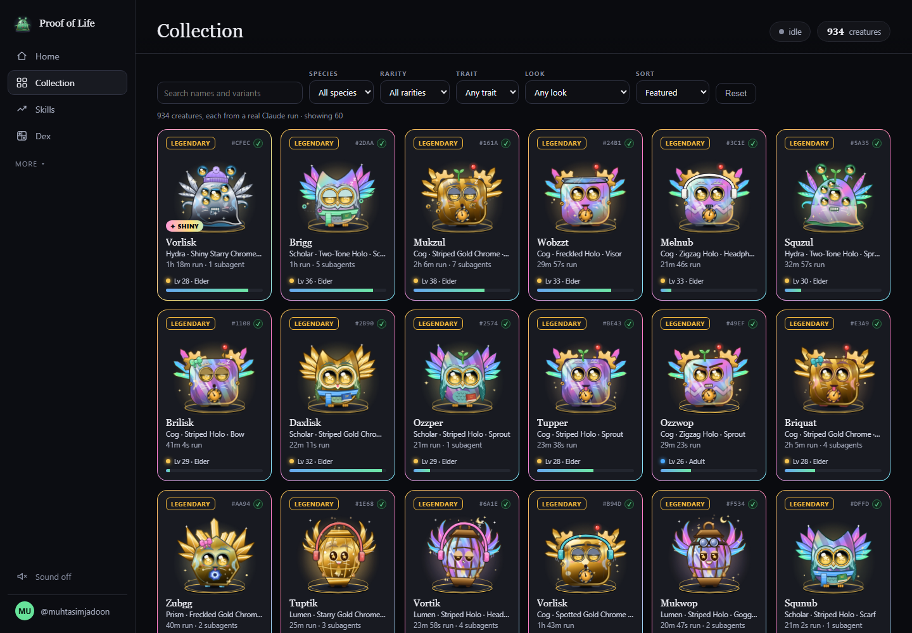

# Proof of Life

**A weekly report of what your Claude Code agents did, by type of work. Every run also hatches a creature, which is what keeps you looking.**



Each creature is a signed, tamper-evident record of one run: nobody can change a record later without it showing. It is your own record, not an audit.

You give an agent a task and wait. When a run starts, an egg starts growing. When it ends, a creature hatches, shaped by what the agent really did. Once a week, **Share this week** saves one card: your runs and hours by type of work ([more below](#your-week-and-live-status)).

- **Species is set by the work done**, read from the tools the agent called and the files it touched: Cog (code), Scholar (research), Moth (writing), Prism (design), Lumen (video), Hydra (outreach), Wisp (browser, computer use and anything general).
- **Rarity is set by what the run got done**, scored from counts only: 1 point per tool call that worked (up to 200), 5 per kind of tool used, 3 per file written or edited (up to 60), 10 per `git commit` (up to 10), 15 per `git push` (up to 5), minus 3 per failed tool call. Common (under 20), Uncommon (20+), Rare (50+), Epic (120+), Legendary (250+ and 3 or more kinds of tool). Run length never raises rarity, so a session left idle for hours stays Common; it only earns the *Marathon* trait. Creatures hatched before Oct 10, 2026 keep the tier their run length gave them (rule 1); new ones carry `ruleVersion: 2` in their signed record. Every tier is a visible upgrade: a pattern and an accessory, then metal trim and glowing eyes, glowing markings and an aura, and at Legendary a silhouette and finish upgrade: a Gold Chrome or Holo body, a pair of wings made for its species, a bigger crest and star eyes. Every creature wears at most one accessory, and nothing ever covers its eyes.
- **Mythic, the top tier,** can't be bought or rushed. Solo, it takes a run with 10 or more subagents that earns Legendary and doesn't fail (*Legion*), or the first run of a 30th day in a row (*Devoted*). Cross-feeding with another operator on the same server also breeds Mythic hybrids.
- **Every creature is one of a kind.** Its colorway (8 per species), pattern, accessory, expression and eyes are read off its signed seed, and about 1 in 64 hatches **Shiny** in chrome or holo. Nothing about the look is stored, so it can't be edited either.
- **It grows up.** Each good run raises the earlier creatures of its kind, on a 60-level curve that slows as it climbs (Lv 2 after one run, Lv 60 after about 400): hatchlings (Lv 1-5) sit in their shell, juveniles (6-14) grow their ornaments in, adults (15-27) are fully grown, elders (28-39) get bushy brows, whiskers and a warm glow, and the Exalted (40+) snow-white brows and a laurel.
- **Traits come from real signals:** *Nightshift* (ran before 5am), *Marathon* (a run of 20 minutes or more), *Swarm* (5+ subagents), *Scarred* (survived a failure).
- **Every creature is signed with Ed25519** the moment it hatches. The signature covers duration, species, tier, seed, tool-call count, a hash of the activity counts, the rule version and owner, so changing any of them later breaks it. That makes the record tamper-evident; see the threat model below for what it does not show.

Same run, same creature, always. Runs under 10 seconds don't hatch, so the shelf stays meaningful.

## Install (2 minutes)

Needs Node 18+ and Claude Code on your own machine. No dependencies, no build step. Pick one way in, not two (two installs count every run twice).

**npx (one command).** Adds four hooks to `~/.claude/settings.json` (backed up first), starts the server in the background and opens http://localhost:4855:
```bash
npx github:muhtasimjadoon/proof-of-life              # remove: npx github:muhtasimjadoon/proof-of-life uninstall
```
After a reboot: `npx github:muhtasimjadoon/proof-of-life start`. Data lives in `~/.proof-of-life/data`, so updates never touch it.

**Claude Code plugin (no terminal, works in the Desktop Code tab).** In a session:
```
/plugin marketplace add muhtasimjadoon/proof-of-life
/plugin install proof-of-life@proof-of-life
```
The plugin starts the server when a session starts and opens the page the first time. Data lives in `~/.proof-of-life/data`.

**git clone.**
```bash
git clone https://github.com/muhtasimjadoon/proof-of-life && cd proof-of-life
node cli.mjs                   # hooks + server + page; remove: node cli.mjs uninstall
```
A clone keeps its data in `./data`. The old way still works: `node install.mjs`, then `node server.js`.

Then use Claude Code as usual. `stop` and `start` work in every path (`npx github:muhtasimjadoon/proof-of-life stop`, `node cli.mjs start`); they only ever stop a server they started.

**After you update the code, restart the server** (`node cli.mjs stop`, then `node cli.mjs start`; npx and the plugin restart their own server when the version changes). The page is read from disk, so it updates at once; the server only loads its code when it starts. If the two don't match, the page says so in a banner instead of quietly showing empty panels (`/api/version` reports the running build).

## Privacy

Everything runs on your machine. Your creatures live in `state.json` in your data folder (`./data` in a git clone, `~/.proof-of-life/data` for npx and the plugin).

- **Your prompts never leave the hook.** The prompt is classified locally into a species key, and only that key is sent to the local server.
- **When a run ends,** the hook reads the transcript and sends only counts: tool names, file extensions from a known list, the first word of shell commands from a known list (`npm`, `git`, `ffmpeg`), how many `git commit` and `git push` commands ran, and how many tool calls came back as errors, plus the start and end times of quiet stretches in the run (so waits on you are not counted as agent time). Anything else is sent as `other`. It never sends file paths, file names, file contents, command arguments, error text or the conversation. When `POL_SERVER` points at another machine, MCP tool names are reduced to a family (`mcp__outreach`, `mcp__browser`), so the host never learns which servers you run.
- The server listens on `127.0.0.1` only, and on loopback it only answers to a loopback `Host`, so a web page that rebinds its domain to your machine can't read or change anything. Requests that change state must be JSON and must come from the page itself or from a hook: a request from another site is refused. Set `POL_HOST=0.0.0.0` to share it; remote requests then need an operator token to read a collection.
- The hooks time out in 1.5 seconds and always exit cleanly. They never slow down or break a session, even if the server is off.
- **Usage stats are off unless you say yes.** The installer asks once (y/N). If you agree, the server (never the hooks) sends one counts-only heartbeat a week: a random install ID, app version, week, runs, active days and runs per type of work. No names, handles, prompts, paths or file contents. Exact schema and how to turn it off: [TELEMETRY.md](TELEMETRY.md).

## Backups and recovery

- `state.json` is written to a temp file, flushed to disk, then renamed, so a crash or power cut can't leave it half-written.
- Every hour (and at every start) the server keeps a copy in `<data>/backups`, the last 48. Set `"backupDir"` in `config.json` (or `POL_BACKUP_DIR`) to keep a second set on another drive.
- Lost it anyway? Your runs are still in Claude Code's own transcripts (`~/.claude/projects`). Stop the server, then:
  ```bash
  node scripts/recover-from-transcripts.mjs --since <last good date> --out runs.json
  node server.js --recover runs.json
  ```
  Each turn goes through the same hatch code as a live run, at its own time, and is signed as usual. Rebuilt creatures are marked `recovered: "transcript"`. Run `--compare` first over a window you still have to check the match.

## Threat model

- **The signing key lives on your machine** (`data/attestor.json`). Whoever holds it can sign anything, so this is your own record, not an audit, and not a third-party attestation.
- **What it shows:** a creature's recorded facts (owner, run length, species, tier, seed, counts) have not been changed since it was signed. Changing any of them later shows when you check the signature.
- **What it does not show:** that the work was useful, that the counts came from a real Claude Code run (someone with the key or the server can post made-up counts), or what the work was about. The hooks only see counts, never content.
- **Not supported: Cowork and cloud sessions.** Proof of Life needs Claude Code hooks running on your own machine.

## Skills

Every creature feeds 28 operator skills on a 1-120 curve (`skills.js`), with prestige stars past 120. A title band every ten levels (Novice, Apprentice, Journeyman, Adept, Expert, Master, Grandmaster, Virtuoso, Luminary, Paragon, Ascendant, Transcendent) and Apex at 120, each with its own color. Rarity words like Legendary and Mythic belong to creatures only.

- **Work:** Engineering, Debugging, Testing, Shipping, Data, Research, Writing, Design, Video, Outreach and Automation, from the tools a run used. Every skill a run really exercised gets its share, plus a floor per real signal, so three `git` calls always feed Shipping.
- **Craft:** Toolsmith, Orchestration, Endurance and Resilience, as bonuses on each run.
- **Habits:** Consistency, Polymath and Night Owl, from your days.
- **Style:** Focus (deep runs of 20 minutes or more), Velocity (runs per active day), Precision (runs with no failed tool call, and clean streaks), Early Bird (5-9am), Weekend Warrior, Explorer (tools and MCP servers used for the first time), Multitasker (runs that overlapped), Terminal (shell commands), Reviewer (read-heavy runs that changed nothing) and Collector (Dex slots filled).

Skills that need tool activity stay locked, with a line saying what unlocks them, until a run that carries it arrives. Runs from before activity tracking count toward the skill of their species. Runs over 4 hours count as 4 hours, and a session left open for more than a day is not counted as machine time.

## The Dex and the Board

The **Dex** has 308 slots: every species in every colorway at every hatch rarity, plus a Mythic, a Shiny and both Legendary editions per species. Each slot is filled by a real, signed creature, and it lists what to find next with the real rule for each.

The **Board** ranks operators on this week's points: every run adds points for what it got done (its outcome score above, log-scaled), never for how long it ran. Runs without activity counts (older hooks) add a base 2. **Power** is the same points for all time. Alone on a server, you race your own records: best day, best week, longest streak, longest run.

## Check a creature's signature

```bash
curl "http://localhost:4855/api/verify?id=<creature id>"   # { "valid": true, ... } = signature intact
curl  http://localhost:4855/api/pubkey                       # the signing public key
curl  http://localhost:4855/api/version                      # the running build
```

## Your week, and live status

- **Share this week** (Home, in *This week*) saves one PNG card of what your agents did this ISO week: runs and hours by type of work (non-code work first, Engineering last), your top creature, the week number and the total runs. It uses only your own runs; bred creatures are not runs, sessions left open are not counted as hours, and time a run spent waiting on you (a permission prompt or a question) is left out of its hours for runs hatched from v1.0 on. The "% not code" line counts only runs typed from what the agent did (tools, files, commands), the same rule as `scripts/stats.mjs`, and says how many runs that is. It only appears when at least half the week's runs were typed that way, so the card never shows a share that its own bars contradict. A week with no runs saves an honest empty card.
- **Live status:** while a run is going, its egg and the top bar say *Working*. When Claude Code asks for permission or asks you a question, the `Notification` hook marks it *Needs your input* until the next prompt, the next finished subagent or the end of the run. When the run ends it shows *Done* for two minutes, with the creature it hatched. Only one word leaves the hook (permission, question or input), never the notice text.
- **Already installed before this?** Re-run the installer once to add the `Notification` hook: `node cli.mjs` in a clone, or `npx github:muhtasimjadoon/proof-of-life`. The plugin picks it up on update.

## Options

| | |
|---|---|
| `POL_PORT` | server port (default 4855) |
| `POL_DATA_DIR` | where creatures are stored (default `./data` in a git clone, `~/.proof-of-life/data` for npx and the plugin) |
| `POL_HOME` | move `~/.proof-of-life` (the npx app copy and its data) |
| `POL_SETTINGS` | install the hooks into another settings file (tests) |
| `npx github:muhtasimjadoon/proof-of-life --no-open --no-start` | install without opening a browser or starting the server |
| `POL_HOST` | listen address (default `127.0.0.1`; `0.0.0.0` to share) |
| `POL_SERVER`, `POL_TOKEN` | point the hooks at a hosted server instead of localhost |
| `node server.js --samples` | add sample operators to explore the Board and cross-breeding |
| `POL_TELEMETRY=off` | never send usage stats, whatever you answered at install ([TELEMETRY.md](TELEMETRY.md)) |
| `npx github:muhtasimjadoon/proof-of-life telemetry on\|off\|status` | change your usage-stats answer without touching hooks (`node cli.mjs telemetry on\|off` in a clone, or the button under How it works → Provenance) |
| `node scripts/stats.mjs [state.json]` | share of your creatures by work type since 2026-10-09 (read-only; default: `state.json` in your data folder) |

## How it works

| File | Job |
|---|---|
| `hooks/run-start.mjs` | `UserPromptSubmit`: lays an egg |
| `hooks/run-subagent.mjs` | `SubagentStop`: counts subagents |
| `hooks/run-notify.mjs` | `Notification`: marks the running egg "needs your input" (permission prompt or question); only one word is sent, never the notice text |
| `hooks/run-end.mjs` | `Stop`: reads what the agent did and hatches the creature; also sends the start and end times of quiet stretches in the run (15 s or more), so time spent waiting on you is not counted as agent time |
| `engine.js` | deterministic creature engine (species, rarity, Mythic, traits, art seed) |
| `skills.js` | skill curve, bands and xp formulas (shared with the browser as `/skills.js`) |
| `public/variants.js` | the collectible look of every seed: colorways, patterns, accessories, faces, Shiny, growth, Dex slots |
| `server.js` | zero-dependency server: signing, storage, API, UI |
| `cli.mjs` | `npx github:muhtasimjadoon/proof-of-life`: install, start, stop, uninstall; `ensure` is the plugin's SessionStart hook |
| `install.mjs` | adds or removes the four hooks in `~/.claude/settings.json` |
| `paths.js` | where data lives for a clone vs an npm, npx or plugin copy |
| `hooks/hooks.json`, `.claude-plugin/` | the Claude Code plugin and its marketplace entry |
| `scripts/smoke.mjs` | install smoke test CI runs on Windows, macOS and Linux (`npm run smoke`) |

## License

MIT
